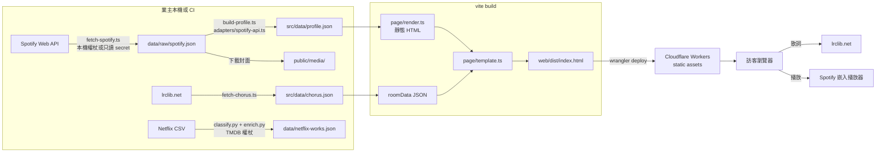

# DESIGN.md — 系統設計

視覺設計系統（顏色、字級、元件）在 `web/DESIGN.md`；這份講資料怎麼流、怎麼建置與部署、信任邊界在哪。

## 目標與限制

- 一頁展示業主自己的聽歌與看劇品味，走 Awwwards 等級的互動體驗：可以走進去的 3D 播放室（Spotify）與放映室（Netflix）。
- 長期要讓任何人產生自己的頁面，但 Spotify 開發模式最多 5 位授權使用者、Netflix 沒有 API，所以多人版的資料入口是**使用者上傳資料檔或搜尋挑選**，不是 OAuth。
- 因此架構從第一天就把「資料來源」和「頁面」切開：任何來源都先轉成 `TasteProfile`。

## 資料流

- **更新頻率**：CI 每週一 00:00（台灣）、每次 push main、手動觸發都會先跑 `data:fetch` → `data:build` → `data:chorus` 再建置部署，資料不 commit 回 repo；PR 不抓資料。業主不公開「此刻在聽什麼」，只讓訪客知道四週以上大概在聽什麼。
- **建置時**：`TasteProfile` 被畫成完整靜態 HTML（沒有 JavaScript 也看得到全部內容），3D 房間需要的資料以 `<script type="application/json" id="room-data">` 內嵌。
- **執行時**：`main.ts` 讀 room-data 啟動 Three.js 房間；歌詞從 lrclib 即時抓，播放交給 Spotify 嵌入播放器。沒有自家後端。

## 模組分層

| 層 | 規則 |
|---|---|
| adapters | 只做「外部格式 → `TasteProfile`」，新增資料來源只加 adapter |
| core | 純函式，由資料算故事、人設、開場曲、副歌位置；有單元測試 |
| page | 字串組 HTML，所有第三方字串經 `esc()`；樣板替換用函式形式 |
| room / live | 瀏覽器端，只用 `textContent` 與 canvas 寫第三方文字 |

## 部署

- Cloudflare Workers static assets，`web/wrangler.jsonc` 沒有 `main`、沒有 bindings 或 secrets；未知路徑回 `index.html`（SPA fallback）。
- 上傳目錄是 `web/dist/`。排除兩層：建置後 `dropDotDirs()` 刪掉點目錄；`@cloudflare/vite-plugin` 產生的 `.assetsignore`（`.*`、`wrangler.json`、`.dev.vars`）。
- **CI 資料更新**（`.github/workflows/deploy.yml`）：憑證來源由 `web/scripts/spotify-credentials.ts` 決定，環境變數三個齊全就只用環境變數（只讀權杖，來自 GitHub secret），否則照舊用 MCP 設定檔。Spotify 換發時回新的 refresh token 會寫到 `SPOTIFY_ROTATED_TOKEN_FILE`，由 workflow 用 `SECRETS_PAT` 的 `gh secret set` 寫回，寫回失敗讓 job 失敗。抓資料失敗：push 警告並用 repo 資料繼續部署；schedule／手動觸發則 job 失敗、不部署。refresh token 約 6 個月要重新授權，到期時週排程失敗會寄信。
- 目前沒有自訂回應標頭（沒有 CSP），規劃見 `intent/harden-public-site.md`。

## 信任邊界

| 邊界 | 控制 |
|---|---|
| 第三方字串 → 建置期 HTML | `esc()`、函式替換、`owner.url` 網域限制；`web/test/template.test.ts` |
| 第三方回應 → 訪客 DOM | `textContent`、`encodeURIComponent`；尚無 CSP |
| 本機工作目錄 → 公開網站 | `dropDotDirs()` ＋ `.assetsignore` |
| 權杖檔 → 其他主體 | 檔案權限 600、`.gitignore`、原子寫入 |
| CI 權杖 → 日誌／公開產物 | 只讀 scope、只有抓資料那一步拿得到 Spotify secret、錯誤訊息不附回應全文、輪替檔寫完即刪、不 commit 資料；`SECRETS_PAT` 只開本 repo Secrets 讀寫 |
| 第三方內容 → LLM → Spotify MCP 寫入工具 | Claude Code 工具核准（寫入工具應設為 ask） |

## 放映室（Netflix）

進行中的變更：`docs/spectra/changes/add-netflix-screening-room/`。定調為「朋友拿著我給的電影票，來我家看電影」，沿用播放室的語法（房間位置＋`data-cam` 鏡頭、第一人稱口吻、文案由資料算出）。交接狀態見 `docs/netflix-todo.md`。
